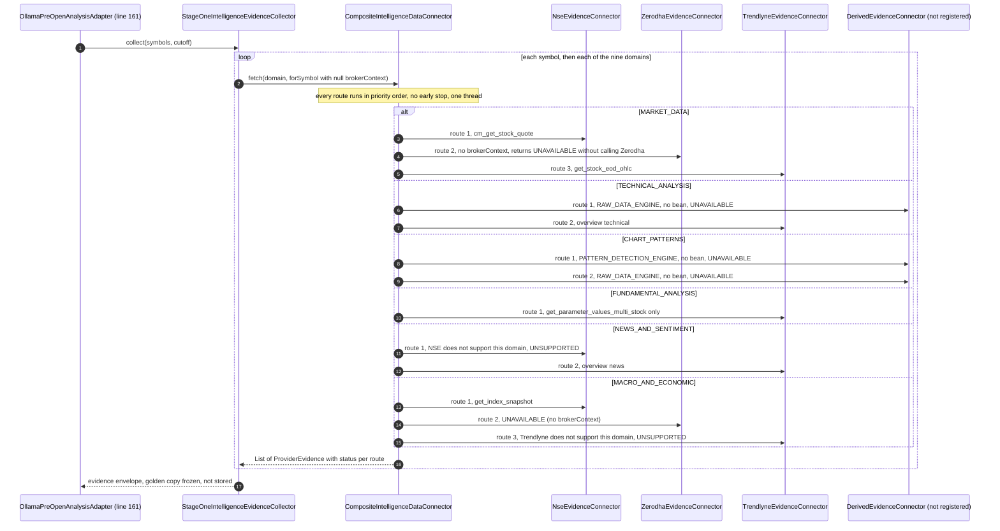

# Current Data-Fetch Implementation (as built today)

- Scope: how the code works today. This is not a proposal.
- Source revision: `main` at commit a6db9a5 (repository `satyapp/predictiveEdge`).
- Method: read-only review of the source. Line numbers refer to that revision. Paths are relative to `backend/predictiveedge-parent/` unless shown otherwise.
- Not done: no build, test, Docker, or runtime check. Behaviour below is what the code says, from reading it. Anything marked "unverified" needs a runtime check.

## 1. Summary

1. Only one path calls the evidence connectors today: the pre-open Ollama analysis path, through `StageOneIntelligenceEvidenceCollector`. The CSV pre-open screen and the market-screen service call Zerodha historical data directly and do not use the connectors.
2. The connector layer calls every route for a domain. It does not stop at the first success. The priority order only sets the call order, which runs one after another on one thread.
3. In the Stage-1 path, the Zerodha connector always returns UNAVAILABLE, because the query it receives has no broker context. The Zerodha route therefore never provides data there.
4. The two derived engines (RAW_DATA_ENGINE, PATTERN_DETECTION_ENGINE) have no implementation and no bean. Their routes always return "Connector is not configured". TECHNICAL_ANALYSIS and CHART_PATTERNS get no engine data.
5. MARKET_DEPTH is not an evidence domain. It comes from the live Zerodha WebSocket feed and is stored in `market_depth_snapshot`. It has no fallback.
6. PRE_OPEN_ANALYSIS is not an evidence domain. It is stored in `pre_open_auction_snapshot` from a user-uploaded NSE pre-open CSV. Intraday history for the screened symbols comes from Zerodha.
7. No `search_id` exists. Evidence from the connector layer is not persisted at all. The golden copy is returned in the API response only.
8. `fetchForResource` has no production caller. Only tests call it. The duplicate-fetch problem in the proposed design is therefore not active today. See section 9.

## 2. Components

| Component | Location | Role |
|---|---|---|
| `EvidenceDomain` | `intelligence-data-connector/.../connector/EvidenceDomain.java:4-13` | Nine domains: MARKET_DATA, TECHNICAL_ANALYSIS, CHART_PATTERNS, FUNDAMENTAL_ANALYSIS, NEWS_AND_SENTIMENT, CORPORATE_ACTIONS, MACRO_AND_ECONOMIC, INSTITUTIONAL_FLOWS, HISTORICAL_AND_PREDICTIVE. No MARKET_DEPTH, no PRE_OPEN_ANALYSIS. |
| `EvidenceSource` | `.../EvidenceSource.java:3-10` | NSE, ZERODHA, TRENDLYNE, RAW_DATA_ENGINE, PATTERN_DETECTION_ENGINE, COINDESK, YAHOO_FINANCE. |
| `IntelligenceSourcePlan` | `.../IntelligenceSourcePlan.java:16-85` | Static routes per domain (`routes()` at 33-55) and domains per decision resource (`resourceDomains()` at 57-79). |
| `CompositeIntelligenceDataConnector` | `.../CompositeIntelligenceDataConnector.java:29-71` | Runs routes. `fetch(domain)` at 29-37, `fetchForResource` at 39-45, per-route call and status mapping at 47-66. |
| `IntelligenceConnectorConfiguration` | `.../IntelligenceConnectorConfiguration.java:12-31` | Registers beans: NSE (14-15), Trendlyne (17-20), Zerodha (22-25), composite (27-30). No derived-engine bean. |
| `NseEvidenceConnector` | `.../NseEvidenceConnector.java:13-42` | NSE MCP. Supports MARKET_DATA, CORPORATE_ACTIONS, MACRO_AND_ECONOMIC, INSTITUTIONAL_FLOWS (13-14). |
| `ZerodhaEvidenceConnector` | `.../ZerodhaEvidenceConnector.java:7-26` | Supports MARKET_DATA, MACRO_AND_ECONOMIC, HISTORICAL_AND_PREDICTIVE (7-8). Needs `brokerContext` and `historicalDataRequest` (19-22). |
| `TrendlyneEvidenceConnector` | `.../TrendlyneEvidenceConnector.java:9-55` | Trendlyne MCP. Supports seven domains (9-17). MACRO_AND_ECONOMIC is not in the list. |
| `DerivedEvidenceConnector` | `.../DerivedEvidenceConnector.java:5-27` | Wraps a `DerivedEvidencePort` for engine sources. Never instantiated. |
| `DerivedEvidencePort` | `.../DerivedEvidencePort.java:1-6` | Interface only. No implementation exists in the repository. |
| `EvidenceQuery` | `.../EvidenceQuery.java` | Immutable query. `forSymbol` at 25-27 sets `brokerContext` and `historicalDataRequest` to null. |
| `StageOneIntelligenceEvidenceCollector` | `chart-intelligence-infrastructure/.../StageOneIntelligenceEvidenceCollector.java` | Builds the evidence envelope. `collect` at 32-42, per-stock loop at 44-, per-domain fetch at 49-53, module coverage at 57-70, `hasSuccess` at 89. |
| `StageOneGoldenCopyFactory` | `chart-intelligence-infrastructure/.../StageOneGoldenCopyFactory.java:24-29` | Fingerprints evidence and analysis (SHA-256). Does not persist. |
| `ChartIntelligenceInfrastructureConfiguration` | `chart-intelligence-infrastructure/.../ChartIntelligenceInfrastructureConfiguration.java` | Wires the collector (37-41) and golden-copy factory (43-46) beans. |
| `OllamaPreOpenAnalysisAdapter` | `chart-intelligence-infrastructure/.../OllamaPreOpenAnalysisAdapter.java` | Calls the collector at 161. Freezes golden copies at 82 and 120. |
| `PreOpenCsvAnalysisController` | `chart-intelligence-api/.../PreOpenCsvAnalysisController.java` | `analyze` at 45 (deterministic), `analyzeWithOllama` at 70. |
| `PreOpenCsvAnalysisService` | `chart-intelligence-application/.../PreOpenCsvAnalysisService.java` | CSV parse at 73, shortlist at 74-77, per-symbol loop at 83, publish at 89, Zerodha history at 91-92 and 119-128, analysis at 101, ranking at 112. |
| `MarketScreenHistoricalAnalysisService` | `chart-intelligence-application/.../MarketScreenHistoricalAnalysisService.java` | Market-screen CSV. Zerodha history at 75 and 94-101. |
| `PreOpenIntradayAnalysisService` | `chart-intelligence-application/.../PreOpenIntradayAnalysisService.java` | Reads stored pre-open snapshots at 36-38. |
| `JdbcPreOpenAuctionStore` | `market-intelligence-infrastructure/.../JdbcPreOpenAuctionStore.java` | `publish` at 33, insert at 44, `latestAtOrBefore` at 59. |
| `JdbcMarketIntelligenceStore` | `market-intelligence-infrastructure/.../JdbcMarketIntelligenceStore.java` | Tick depth publish at 102, insert into `market_depth_snapshot` at 110, `latestAtOrBefore` at 123. |
| `MarketIntelligenceTickConsumer` | `market-intelligence-application/.../MarketIntelligenceTickConsumer.java` | `onTicks` at 108. Publishes depth at 194. |
| `ZerodhaLiveMarketDataProvider` | `broker-zerodha-adapter/.../ZerodhaLiveMarketDataProvider.java:22-41` | Live stream via `connect` at 41. |
| `ZerodhaTickerPacketDecoder` | `broker-zerodha-adapter/.../ZerodhaTickerPacketDecoder.java` | Accepts only FULL mode (32-33). Decodes depth at 93. |
| `UserMarketDataSubscriptionManager` | `broker-connection-application/.../UserMarketDataSubscriptionManager.java` | `subscribe` at 33. |
| `SafetySnapshotProducer` | `trading-decision-application/.../SafetySnapshotProducer.java` | `assess` at 70. Reads stored depth at 75. |
| `FyersAdapterConfiguration` | `fyers-adapter/.../FyersAdapterConfiguration.java` | Enabled by property (21). Registers `@Primary HistoricalMarketDataProvider` (42-43). |
| `BrokerConnectionInfrastructureConfiguration` | `broker-connection-infrastructure/.../BrokerConnectionInfrastructureConfiguration.java` | Registers `zerodhaHistoricalDataProvider` (89-91). |

## 3. The Stage-1 evidence path (the only connector caller)

**Trigger.** `OllamaPreOpenAnalysisAdapter.analyze(result)` (line 72) builds the JSON envelope at line 161 with `intelligence.collect(...)`. The adapter's `analyze` methods are wired in `ChartIntelligenceInfrastructureConfiguration` (around 141-152). `OllamaMarketScreenAnalysisAdapter` also takes the collector (not read in detail; unverified).

**Collect.** `StageOneIntelligenceEvidenceCollector.collect` (32-42):
- writes `required_module_count` from `DecisionResourceType.values()` (12, enum at `DecisionResourceType.java:4-17`);
- loops over unique symbols (40) and calls `stock(symbol, cutoff)`.

**Per stock.** For each of the nine `EvidenceDomain` values (49-53):
- `connector.fetch(domain, EvidenceQuery.forSymbol(symbol, query(domain, symbol), cutoff))`;
- the query text is generated per domain (`query` helper, lines 96-102);
- results are stored once per domain in `evidence` (53).

**Module coverage.** For each `DecisionResourceType` (57-70), it looks up the domains from `IntelligenceSourcePlan.domainsFor` (62). It counts domains with a SUCCESS (64) and sets `evidence_coverage` to NO_EVIDENCE, PARTIAL_EVIDENCE or ALL_DOMAINS_HAVE_EVIDENCE (66-67). It sets `decision_resource_ready` to false (68). Coverage is therefore a count of domains with any SUCCESS, not a quality check.

**Composite.** `CompositeIntelligenceDataConnector.fetch(domain, query)` (29-37):
- takes `IntelligenceSourcePlan.routesFor(domain)`;
- sorts by `priority` (33);
- maps each route through `fetch(route, query)` (47-66).

Status mapping in `fetch(route, query)`:

| Condition | Status | Lines |
|---|---|---|
| No connector registered for the route's source | UNAVAILABLE "Connector is not configured" | 48-50 |
| Connector does not support the domain | UNSUPPORTED | 52-54 |
| Connector returns null | UNAVAILABLE "No evidence returned" | 58 |
| Connector returns a value | SUCCESS | 59 |
| Connector throws `EvidenceUnavailableException` | UNAVAILABLE | 60-61 |
| Connector throws any other `RuntimeException` | FAILED "Connector failure: <class name>" | 62-63 |

**No early stop.** `fetch(domain)` maps every route. A SUCCESS from the first route does not stop the later routes. Every route is called, which is why the proposed design's "stop at first usable source" would be a behaviour change.

## 4. Sequence of the current behaviour

## 5. Current behaviour per data type

Routes are from `IntelligenceSourcePlan.routes()` (lines in parentheses). "Today" is what happens in the Stage-1 path.

| Data type | Routes in plan (priority) | What happens today | Gaps |
|---|---|---|---|
| MARKET_DATA | NSE (35, P1), Zerodha (35, P2), Trendlyne (36, P3) | NSE quote runs. Zerodha route returns UNAVAILABLE because `forSymbol` passes no broker context (`EvidenceQuery.java:25-27`, `ZerodhaEvidenceConnector.java:19-22`). Trendlyne EOD runs. All three are called. | Zerodha never supplies data here. No fallback. Results are not persisted. |
| MARKET_DEPTH | Not an evidence domain | Not fetched by Stage-1. Live depth comes from the Zerodha WebSocket in FULL mode: `ZerodhaLiveMarketDataProvider.connect` (41), `ZerodhaTickerPacketDecoder` (32-33, depth at 93). Subscription via `UserMarketDataSubscriptionManager.subscribe` (33). Consumer `MarketIntelligenceTickConsumer.onTicks` (108) publishes depth at 194. Stored by `JdbcMarketIntelligenceStore.publish` (102) into `market_depth_snapshot` (110). Read by `SafetySnapshotProducer.assess` (70, 75) via `latestAtOrBefore` (123). | No NSE depth. No fallback. No searchID. The read used for execution safety is not the Stage-1 envelope. |
| PRE_OPEN_ANALYSIS | Not an evidence domain | CSV path: `PreOpenCsvAnalysisController.analyze` (45) calls `PreOpenCsvAnalysisService.analyze` (68). Parse (73), shortlist by turnover (74-77), publish each shortlisted row to `pre_open_auction_snapshot` (89, `JdbcPreOpenAuctionStore.publish` line 33, insert 44). Read path `PreOpenIntradayAnalysisService.analyzeStored` (36-38) through `latestAtOrBefore` (`JdbcPreOpenAuctionStore` 59). | Source is the uploaded NSE CSV only. No broker or NSE API call for pre-open data. No fallback. |
| TECHNICAL_ANALYSIS | RAW_DATA_ENGINE (37, P1 DERIVED), Trendlyne (38, P2) | Raw-data engine route returns UNAVAILABLE "Connector is not configured" (no bean). Trendlyne overview technical runs (`TrendlyneEvidenceConnector.java:39`). | No engine is implemented or registered. |
| FUNDAMENTAL_ANALYSIS | Trendlyne (41, P1) | Trendlyne `get_parameter_values_multi_stock` (`TrendlyneEvidenceConnector.java:40`). | Single source. No fallback. |
| CHART_PATTERNS | PATTERN_DETECTION_ENGINE (39, P1), RAW_DATA_ENGINE (39, P2) | Both UNAVAILABLE (not configured). | Chart patterns never produced in Stage-1. |
| NEWS_AND_SENTIMENT | NSE (42, P1), Trendlyne (43, P2), Yahoo (44, P3) | NSE returns UNSUPPORTED. Trendlyne overview news runs. Yahoo has no connector. | Effectively Trendlyne only. |
| CORPORATE_ACTIONS | NSE (45), Trendlyne (46) | NSE `get_corporate_actions` runs. Trendlyne events runs. | Both called. |
| MACRO_AND_ECONOMIC | NSE (47, P1), Zerodha (48, P2), Trendlyne (49, P3) | NSE index snapshot runs. Zerodha UNAVAILABLE. Trendlyne UNSUPPORTED (not in its list, lines 9-17). | Effectively NSE only. |
| INSTITUTIONAL_FLOWS | NSE (50), Trendlyne (51) | NSE market mood and Trendlyne ownership both run. | Both called. |
| HISTORICAL_AND_PREDICTIVE | Zerodha (52, P1), Trendlyne (53, P2) | Zerodha UNAVAILABLE (no context). Trendlyne EOD runs. | Effectively Trendlyne only in Stage-1. |

Notes:
- The Zerodha connector is still used by two services that do not go through the composite: `PreOpenCsvAnalysisService` (history at 91-92, 119-128) and `MarketScreenHistoricalAnalysisService` (75, 94-101). These call `HistoricalMarketDataProvider.historicalCandles` directly.
- The Zerodha evidence bean (`IntelligenceConnectorConfiguration.java:22-25`) is injected with a `HistoricalMarketDataProvider`. The Fyers configuration registers a `@Primary` `HistoricalMarketDataProvider` when enabled (`FyersAdapterConfiguration.java:21, 42-43`). Spring then injects Fyers wherever a single `HistoricalMarketDataProvider` is needed, including the Zerodha evidence connector and the two services above. Unverified at runtime, but it follows from the `@Primary` rule.

## 6. Fallback behaviour today

- There is no fallback in the connector layer. `fetch(domain)` runs all routes and reports each one. Priority only sets the order.
- Calls run sequentially on the calling thread. There is no executor in the intelligence path. The only executors are in the Zerodha adapter (for example `ZerodhaTickerStream`), not in the evidence path.
- The live depth path (MARKET_DEPTH) has no alternative source at all.
- The pre-open path has no alternative source. It does not fall back to a broker call if the CSV is missing.

## 7. Persistence today

| What | Where | Keyed by | Written when | Notes |
|---|---|---|---|---|
| Stage-1 evidence envelope (`ProviderEvidence` per route) | Not persisted | n/a | n/a | Built in memory by `StageOneIntelligenceEvidenceCollector`, serialised into the Ollama request at 161 and into the response. |
| Golden copy (fingerprint, analysis, evidence JSON) | Not persisted | n/a | Created in `StageOneGoldenCopyFactory.freeze` (24-29) | Returned in the API response. `StageOneGoldenCopy` has status `PLANNED_PHASE_2` (`StageOneGoldenCopyFactory.java:26-27`). No store exists. |
| Market depth | `market_intelligence.market_depth_snapshot` (V015) | user, broker account, instrument, exchange timestamp, received timestamp, evidence hash | Each FULL tick with depth (`JdbcMarketIntelligenceStore.publish` 102-110) | Read by `latestAtOrBefore` (123). Has no `search_id`. |
| Pre-open auction | `market_intelligence.pre_open_auction_snapshot` (V016) | user, broker account, venue, symbol, trading date, observed and received timestamps, evidence hash | Each shortlisted row of an uploaded CSV (`PreOpenCsvAnalysisService.java:89`) | Read by `latestAtOrBefore` (`JdbcPreOpenAuctionStore.java:59`). Has no `search_id`. |
| Broker account evidence | `broker_evidence.account_snapshot` (V015) | user, broker account, observed time | Not read in detail here | Separate from the evidence connector layer. |
| `search_id` | Not present | n/a | n/a | No occurrence in the repository. |

## 8. The 12 decision modules

Mapping from `IntelligenceSourcePlan.resourceDomains()` (lines 57-79). The module names are `DecisionResourceType` values in `DecisionResourceType.java:4-17`.

| Module | Domains in plan (line) | Stage-1 data actually reachable today |
|---|---|---|
| MARKET | MARKET_DATA, FUNDAMENTAL, NEWS, CORPORATE_ACTIONS, MACRO, INSTITUTIONAL (59-60) | NSE quote, Trendlyne fundamentals, Trendlyne news, NSE corporate actions, NSE index, NSE market mood |
| CHART | MARKET_DATA, TECHNICAL, CHART_PATTERNS, HISTORICAL (61-62) | NSE quote, Trendlyne technical, Trendlyne EOD. Chart patterns none. |
| SCANNER | MARKET_DATA, TECHNICAL, NEWS, INSTITUTIONAL (63-64) | NSE quote, Trendlyne technical and news, NSE and Trendlyne institutional |
| STRATEGY | TECHNICAL, CHART_PATTERNS, FUNDAMENTAL, NEWS, MACRO, HISTORICAL (65-66) | Trendlyne technical, fundamentals, news, Trendlyne EOD. Chart patterns none, macro from NSE. |
| RISK | MARKET_DATA, NEWS, MACRO (67) | NSE quote, Trendlyne news, NSE index |
| PORTFOLIO | MARKET_DATA, FUNDAMENTAL, CORPORATE_ACTIONS, INSTITUTIONAL (68-69) | NSE quote, Trendlyne fundamentals, NSE corporate actions, institutional |
| LEARNING | HISTORICAL (70) | Trendlyne EOD only (Zerodha UNAVAILABLE in Stage-1) |
| DATA_QUALITY | All nine (71) | Coverage is computed for all nine domains. It does not check quality. |
| REGIME_DRIFT | MARKET_DATA, TECHNICAL, MACRO, INSTITUTIONAL, HISTORICAL (72-73) | NSE quote, Trendlyne technical, NSE macro, institutional, Trendlyne EOD |
| EXECUTION | MARKET_DATA (74) | NSE quote and Trendlyne EOD. Execution depth is read separately by `SafetySnapshotProducer`, not from this envelope. |
| VALIDATION | TECHNICAL, CHART_PATTERNS, HISTORICAL (75-76) | Trendlyne technical, Trendlyne EOD. Chart patterns none. |
| CALIBRATION | HISTORICAL (77) | Trendlyne EOD only |

`decision_resource_ready` is false for every module (`StageOneIntelligenceEvidenceCollector.java:68`). The envelope is evidence only.

## 9. Gaps and corrections

Missing or not implemented:

1. **Zerodha in Stage-1 is always UNAVAILABLE.** `EvidenceQuery.forSymbol` (25-27) passes null for `brokerContext` and `historicalDataRequest`. `ZerodhaEvidenceConnector` (19-22) then throws `EvidenceUnavailableException`.
2. **No derived engines.** `DerivedEvidencePort` has no implementation. `DerivedEvidenceConnector` is never constructed. `IntelligenceConnectorConfiguration` (12-31) has no bean for it. TECHNICAL_ANALYSIS and CHART_PATTERNS get no engine output.
3. **Trendlyne does not support macro.** The plan routes MACRO_AND_ECONOMIC to Trendlyne (`IntelligenceSourcePlan.java:49`), but `TrendlyneEvidenceConnector` does not list it (9-17). The route returns UNSUPPORTED on every run.
4. **NSE does not support news.** The plan routes NEWS_AND_SENTIMENT to NSE as PRIMARY (`IntelligenceSourcePlan.java:42`). NSE does not list it (`NseEvidenceConnector.java:13-14`). The route returns UNSUPPORTED on every run.
5. **MARKET_DEPTH and PRE_OPEN_ANALYSIS are outside the evidence layer.** They have their own stores and no fallback.
6. **Pre-open data has no broker or NSE API source.** Only the uploaded CSV feeds `pre_open_auction_snapshot`.
7. **Evidence is never persisted.** The golden copy is returned, not stored. There is no `search_id`.
8. **Zerodha label on a possibly Fyers provider.** See section 5 notes. Unverified at runtime.
9. **`fetchForResource` has no production caller.** Its only callers are the interface, the composite, and two tests (`IntelligenceDataConnector.java`, `CompositeIntelligenceDataConnectorTest.java`, `StageOneIntelligenceEvidenceCollectorTest.java`).

Corrections to the proposed design (`Multi-Broker-Data-Fetch-Refactor-Design.md`, section 1):

- Gap 2 ("duplicate fetches") is **latent, not active**. Production calls `fetch(domain)` once per domain per stock, so no duplicate fetch happens in Stage-1. The duplication occurs only if someone calls `fetchForResource` for each of the 12 resources.
- Gap 1 ("no real fallback") is correct.
- Gap 4 (policy) is correct.
- The new findings above (Zerodha always UNAVAILABLE in Stage-1, derived engines missing, Trendlyne macro and NSE news unsupported, Fyers `@Primary` injection) were not in the proposed design and should be added to it if you want the design to match the code.

## 10. Verification status

- Read-only review of `main` at a6db9a5. No build, test, or runtime run.
- Unverified: the Fyers `@Primary` injection order, which symbols the collector receives at line 161, the body of `OllamaMarketScreenAnalysisAdapter`, and the `broker_evidence.account_snapshot` writer.
- No code was changed. The proposed design file was not changed.
