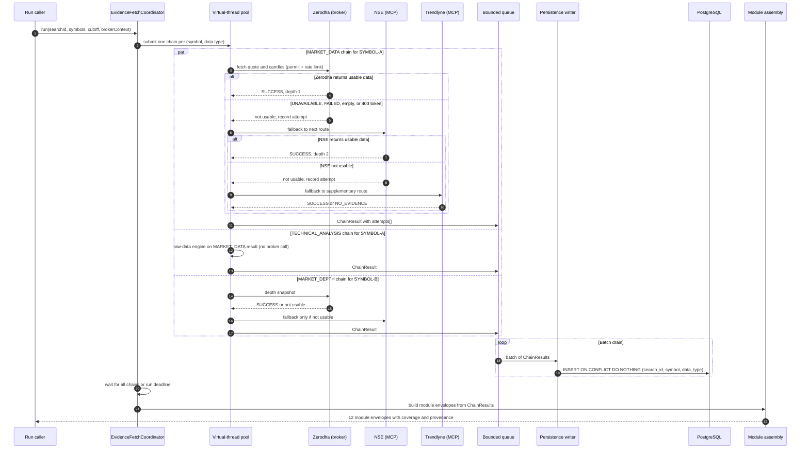

# Multi-Broker Data Fetch Refactor: Design

- Status: Proposed, awaiting review
- Date: 2026-11-24
- Scope: equity data fetching for the Stage-1 intelligence evidence path
- Source revision: `main` at a6db9a5

This document describes the current data-fetching flow, the proposed broker fallback strategy, the multithreaded fetch module, persistence keyed by searchID, and how the twelve governed decision modules map to data types. It changes no code.

## 1. Current data-fetching flow

Paths are under `backend/predictiveedge-parent/`.

- **Domains.** `EvidenceDomain` (intelligence-data-connector) has nine domains: MARKET_DATA, TECHNICAL_ANALYSIS, CHART_PATTERNS, FUNDAMENTAL_ANALYSIS, NEWS_AND_SENTIMENT, CORPORATE_ACTIONS, MACRO_AND_ECONOMIC, INSTITUTIONAL_FLOWS, HISTORICAL_AND_PREDICTIVE. There is no MARKET_DEPTH or PRE_OPEN_ANALYSIS domain yet.
- **Routing.** `IntelligenceSourcePlan` maps each domain to a list of routes (source, role, priority). It also maps each of the twelve `DecisionResourceType` values to its domains.
- **Composite.** `CompositeIntelligenceDataConnector.fetch(domain, query)` runs every route for that domain, sorted by priority. It does not stop at the first success. Each route yields a `ProviderEvidence` with status SUCCESS, UNSUPPORTED, UNAVAILABLE or FAILED.
- **Connectors.** `NseEvidenceConnector` (NSE MCP), `ZerodhaEvidenceConnector` (historical candles via the broker SPI), and `TrendlyneEvidenceConnector` (Trendlyne MCP). Derived engines sit behind `DerivedEvidencePort`.
- **Stage-1 collector.** `StageOneIntelligenceEvidenceCollector` (chart-intelligence-infrastructure) calls `connector.fetch(domain)` once per domain per stock, then computes module coverage from that map. It does not re-fetch per module.
- **Persistence today.** `market_intelligence.market_depth_snapshot` (V015) and `market_intelligence.pre_open_auction_snapshot` (V016) are point-in-time tables keyed by user, broker account, venue and symbol. Neither is keyed by a search run. The identifier `search_id` does not appear in the repository.

**Gaps against the requirements**

1. **No real fallback.** `fetch(domain)` calls every route, so a Zerodha success does not stop the NSE call.
2. **Duplicate fetches.** `fetchForResource(resource)` calls `fetch(domain)` for each domain the resource needs. MARKET_DATA is used by seven resources (MARKET, CHART, SCANNER, RISK, PORTFOLIO, REGIME_DRIFT, EXECUTION), so building each resource separately repeats the same provider calls up to seven times per stock.
3. **Sequential.** Routes and domains run on one thread. The intelligence path has no executor.
4. **Policy conflict.** `docs/architecture/core-ai/Intelligence-Data-Connector-v0.1.md` says "There is no silent fallback or source substitution." This refactor changes that rule and needs a decision (section 7).
5. **Missing domains.** MARKET_DEPTH and PRE_OPEN_ANALYSIS have no domain, route, connector, or search-scoped persistence.

**Keep.** `ProviderEvidence` (status, detail, fetchedAt), the `EvidenceFetchStatus` vocabulary, route `role` (PRIMARY, DERIVED, SUPPLEMENTARY, OPTIONAL), and cutoff-based point-in-time queries. These already give the audit trail that fallback needs.

## 2. Proposed fallback-broker strategy

**Rule.** For each (symbol, data type) there is one ordered chain of sources. Call the first source. If its result is usable, stop. If not, call the next one. Never call a source twice for the same symbol and data type in one run.

**Usable result.** Status SUCCESS, payload non-null and non-empty (for example, at least one candle or a quote), and every timestamp at or before the evidence cutoff. Anything else advances the chain: UNAVAILABLE, FAILED, UNSUPPORTED, an empty payload, or a point-in-time violation.

**Proposed chains** (order is open for review; see section 7)

| Data type | Chain (first to last) | Notes |
|---|---|---|
| MARKET_DATA | Zerodha (broker, PRIMARY) → NSE (PRIMARY) → Trendlyne (SUPPLEMENTARY) | Current code orders NSE first. Broker-first matches "single broker first." |
| MARKET_DEPTH (new) | Zerodha live depth snapshot → NSE depth (to verify) | Zerodha depth comes from the live ticker path. Persist to `market_depth_snapshot`. |
| PRE_OPEN_ANALYSIS (new) | Zerodha pre-open auction snapshot → NSE pre-open (to verify) | Persist to `pre_open_auction_snapshot`. The CSV upload path (`PreOpenCsvAnalysisController`) stays as an explicit operator source, outside the chain. |
| TECHNICAL_ANALYSIS | Raw-data technical engine (DERIVED) → Trendlyne (SUPPLEMENTARY) | The engine runs on the MARKET_DATA result and makes no broker call of its own. |
| FUNDAMENTAL_ANALYSIS | Trendlyne only | No fallback exists. Recorded as a single-source gap. |
| NEWS_AND_SENTIMENT, CORPORATE_ACTIONS, INSTITUTIONAL_FLOWS | NSE → Trendlyne | Same as today. |
| MACRO_AND_ECONOMIC | NSE → Zerodha → Trendlyne | Same as today. |
| HISTORICAL_AND_PREDICTIVE | Zerodha → Trendlyne | Same as today. |
| CHART_PATTERNS | Pattern-detection engine (DERIVED) → Raw-data engine | Same as today. |

**Error handling inside a chain**

1. **Broker session loss.** Kite `403 TokenException` counts as UNAVAILABLE for this run. The chain moves on, and the existing invalidation policy applies: delete the local token and require reconnect.
2. **Transport or 5xx.** One attempt per source per run, with a short bounded backoff. Then advance. No unbounded retries.
3. **Rate limits.** Each source has its own limiter (section 3). A throttled source counts as UNAVAILABLE, not FAILED.
4. **Cutoff.** Fallback results must satisfy the same cutoff as the primary. No look-ahead when a secondary source is used.

**Provenance, not silent substitution.** The chain result records the selected source, selected role, fallback depth (1 = primary), and every attempted route with its status. This keeps the existing audit trail and answers the "no silent substitution" concern without blocking fallback. Downstream modules see the selected source and depth, and DATA_QUALITY can score fallback use.

**Result.** Each chain produces one `ChainResult` per (symbol, data type). Every module reads from that shared result, so no module triggers a fetch.

## 3. Thread pool design

All provider I/O runs in one new multithreaded module. Modules never call providers directly.

**Component.** `EvidenceFetchCoordinator` in `intelligence-data-connector`. It accepts a run (searchId, symbols, cutoff, broker context) and returns one `ChainResult` per (symbol, data type). It replaces `CompositeIntelligenceDataConnector.fetch` on the Stage-1 path. The composite stays for compatibility until callers move over.

**Unit of work.** One chain = one (searchId, symbol, data type). Chains run in parallel across symbols and data types. Routes inside one chain run in sequence, because fallback needs the earlier result first.

**Executor.** `Executors.newVirtualThreadPerTaskExecutor()` (Java 21) is recommended. The work is network I/O, so the limit is provider throughput, not CPU. Concurrency is capped by:

- a per-source `Semaphore` (for example NSE, Zerodha, Trendlyne), sized from config;
- a per-source token-bucket rate limiter (Kite limits to be confirmed from official docs before setting values);
- a global cap on in-flight chains.

`StructuredTaskScope` is not recommended yet because it is a preview API in Java 21.

**No duplicate fetches.** A `ConcurrentHashMap<FetchKey, CompletableFuture<ChainResult>>` keyed by (searchId, symbol, data type, cutoff) uses `computeIfAbsent`. A second caller for the same key gets the same future. The map is scoped to one run and is discarded when the run ends. Cross-run reuse goes through persistence, not this map.

**Timeouts and deadlines.** Each attempt has its own timeout. Each run has a deadline. When the deadline passes, unfinished chains are cancelled and recorded as UNAVAILABLE with reason `RUN_DEADLINE`. Completed results are kept.

**Hand-off to persistence.** Completed `ChainResult`s go onto a bounded queue. A single writer thread drains it in batches and writes to the database (section 4). A slow database therefore fills the queue and slows the fetch threads, which is the intended backpressure. Results are never dropped.

**Module assembly.** After the deadline, or when all chains finish, `StageOneIntelligenceEvidenceCollector` builds the module envelopes from `ChainResult`s. This step is pure computation with no I/O.

**Thread safety.** `EvidenceQuery` is already an immutable record. Source connectors must be stateless per call or thread-safe. Broker context is passed per call and never stored on a shared connector.

**Sizing.** Start with an in-flight cap of about eight chains and tune against real provider limits. These are starting values, not measured numbers.

## 4. Persistence keyed by searchID

Fetching and persistence are separate. The fetch module depends only on an `EvidenceResultSink` interface. The database implementation lives in the infrastructure layer. Fetch never waits on SQL except through the bounded queue in section 3.

**searchID.** A UUID generated by the caller before the run starts. One run equals one searchID. A re-run gets a new searchID. Nothing is overwritten. This identifier is new to the repository.

**Proposed tables** (migration V017, to be written after approval)

1. `market_intelligence.search_run`: `search_id` (PK), `user_id`, `cutoff`, `created_at`, `symbol_count`, `required_module_count` (12), `schema_version`, `status`.
2. `market_intelligence.evidence_chain_result`: `search_id`, `symbol`, `data_type`, `selected_source`, `selected_role`, `fallback_depth`, `status`, `fetched_at`, `attempts` (jsonb, every route tried with its status and detail), `payload` (jsonb, stored once), `payload_hash` (char 64). Unique on (`search_id`, `symbol`, `data_type`). Index on (`user_id`, `symbol`, `data_type`, `fetched_at` desc) for history lookups.
3. Existing `market_depth_snapshot` and `pre_open_auction_snapshot` stay as they are. V017 adds a nullable `search_id` column to each and links every row to its run. Their own point-in-time key (user, broker account, venue, symbol, timestamps) is unchanged.

**Write path.** The single writer from section 3 batches rows into `evidence_chain_result` using `INSERT ... ON CONFLICT (search_id, symbol, data_type) DO NOTHING`, so retries are idempotent. Writes never update a row.

**Read path.** Modules and the golden copy read by searchID. Given a searchID, the full evidence envelope can be rebuilt without calling any provider again.

**Golden copy.** `StageOneGoldenCopyFactory` already fingerprints the evidence JSON. Add `search_id` and `schema_version` to that fingerprint so a stored analysis can be traced to its run.

**Module outputs.** Each module's decision output should also carry `search_id`, so every output can be traced to the chain results it used.

**Not decided here.** Retention period and whether raw payloads are compressed. See section 7.

## 5. Module to data-type mapping

**Rule for every module.** A module never calls a provider. It reads `ChainResult`s for its searchID. The module-to-type map is data in `IntelligenceSourcePlan`, so changing it is a configuration change, not a code path change.

The five requested data types map as follows. The first two are new domains that do not exist yet.

| Data type | Status today | Maps to |
|---|---|---|
| MARKET_DATA | Exists as `EvidenceDomain.MARKET_DATA` | Chain in section 2 |
| MARKET_DEPTH | New domain. Persisted today only by the V015 table | Zerodha live depth → NSE depth (to verify) |
| PRE_OPEN_ANALYSIS | New domain. Persisted today only by the V016 table, and reached only via CSV | Zerodha pre-open → NSE pre-open (to verify) |
| TECHNICAL_ANALYSIS | Exists | Raw-data engine → Trendlyne |
| FUNDAMENTAL_ANALYSIS | Exists | Trendlyne only |

**Module matrix** (✓ = consumes the type; other existing domains are listed last)

| Module | MARKET_DATA | MARKET_DEPTH | PRE_OPEN | TECHNICAL | FUNDAMENTAL | Other existing domains |
|---|---|---|---|---|---|---|
| MARKET | ✓ | | ✓ | | ✓ | News, corporate actions, macro, institutional flows |
| CHART | ✓ | | | ✓ | | Chart patterns, historical |
| SCANNER | ✓ | ✓ | ✓ | ✓ | | News, institutional flows |
| STRATEGY | | | ✓ | ✓ | ✓ | Chart patterns, news, macro, historical |
| RISK | ✓ | | | | | News, macro |
| PORTFOLIO | ✓ | | | | ✓ | Corporate actions, institutional flows |
| LEARNING | | | | | | Historical |
| DATA_QUALITY | ✓ | ✓ | ✓ | ✓ | ✓ | All domains, to check freshness, gaps and fallback depth |
| REGIME_DRIFT | ✓ | | | ✓ | | Macro, institutional flows, historical |
| EXECUTION | ✓ | ✓ | | | | None |
| VALIDATION | | | | ✓ | | Chart patterns, historical |
| CALIBRATION | | | | | | Historical |

**Notes**

- The MARKET_DEPTH and PRE_OPEN rows are a proposal. Confirm them (section 7).
- Coverage per module keeps today's labels: ALL_DOMAINS_HAVE_EVIDENCE, PARTIAL_EVIDENCE, NO_EVIDENCE. It is computed from the chain results for that module's types.
- `decision_resource_ready` stays false in the evidence envelope. Readiness is decided elsewhere, as the current code already states.
- LEARNING, CALIBRATION and VALIDATION mostly consume historical outcomes, so they run after the live chains complete, not in parallel with them.

## 6. Sequence diagram: modules and broker fallback

One run for one symbol and one data type, plus fan-out to other chains.

**Reading the diagram.** Each chain makes at most one call per source. The `alt` blocks are the only branching, and each fallback step is recorded in `attempts[]`. Parallel chains (`par`) never wait on each other, so a slow Trendlyne call on one symbol does not hold up Zerodha on another.

## 7. Open questions

1. **Chain order for MARKET_DATA.** Today NSE is tried before Zerodha. The request says "single broker first." *Recommendation:* Zerodha first, then NSE, then Trendlyne.
2. **Is FYERS the "next broker"?** `fyers-adapter` exists in the repository, but it is not in any intelligence route today. *Recommendation:* add FYERS as a broker route for MARKET_DATA and MARKET_DEPTH, after Zerodha and before NSE.
3. **Policy change.** `Intelligence-Data-Connector-v0.1.md` says "no silent fallback or source substitution." *Recommendation:* allow fallback to NSE or Trendlyne, record the selected source, role and depth on every result, and let DATA_QUALITY penalize fallback use. Then update that document.
4. **What counts as "data received"?** For example, Zerodha returns candles for three of five requested days. *Recommendation:* a partial result is usable only when it covers the required lookback. Otherwise it advances the chain.
5. **MARKET_DEPTH and PRE_OPEN mapping.** Confirm or change the matrix in section 5.
6. **Pre-open source.** Is the CSV upload still the operator source, or should a broker pre-open snapshot be primary? Zerodha and NSE availability of pre-open data through their APIs is not confirmed. *Recommendation:* verify before building the chain.
7. **Who creates the searchID?** *Recommendation:* one per user-triggered run, created by the caller and passed in. Automatic re-runs never reuse a searchID.
8. **Retention.** How long to keep raw payloads in `evidence_chain_result`, and whether to compress them. *Recommendation:* keep 180 days of raw payloads and keep hashes indefinitely. Decide after measuring storage size.
9. **Rate limits and concurrency.** Kite and NSE limits must be confirmed from official documentation before section 3's values are set. Is there a ceiling you want treated as fixed?
10. **Scope of the change.** Should `CompositeIntelligenceDataConnector` and `fetchForResource` be removed in this phase, or kept until callers move over? *Recommendation:* keep them until the Stage-1 path is migrated, then remove them in a follow-up.

## Verification status

- Read-only review of the repository. No build, test, or Docker command was run.
- The MARKET_DEPTH and PRE_OPEN rows, the Kite and NSE rate limits, and the pre-open availability are unverified and are listed above.

Claude artifact copy of this design: https://claude.ai/artifact/7yzsUP9qwCEJBgFbtMwcya

---
_Generated by [Claude Code](https://claude.ai/code)_
