# Pre-open and market-screen recommendation flow v0.1

| Field | Value |
|---|---|
| Status | Agreed target process; implementation is incremental |
| Scope | NSE cash-equity pre-open, top gainers and top losers |
| First-level model | Local Ollama |
| Recommendation authority | Governed final Decision Intelligence |
| Execution boundary | Advisory only; trader executes manually |

Editable Mermaid source:
[`diagrams/pre-open-market-screen-recommendation-flow-v0.1.mmd`](./diagrams/pre-open-market-screen-recommendation-flow-v0.1.mmd).

```mermaid
flowchart TB
    START([Scheduled or user-triggered analysis])

    subgraph DISCOVERY["1. NSE equity discovery"]
        PRE["NSE pre-open auction data"]
        GAIN["NSE top gainers"]
        LOSS["NSE top losers"]
        FILTER["Deterministic eligibility filters\nEQ series + liquidity + spread + turnover + data quality"]
        RANK["Rank candidates\nshortlist at most 20"]
        PRE --> FILTER
        GAIN --> FILTER
        LOSS --> FILTER
        FILTER --> RANK
    end

    START --> DISCOVERY
    RANK --> EACH["For each shortlisted candidate"]

    subgraph EVIDENCE["2. Point-in-time evidence collection"]
        NSE["NSE MCP\nquotes + indices + corporate actions + flows"]
        ZERODHA["Zerodha\nhistorical bars + live market + account context"]
        TRENDLYNE["Trendlyne MCP\nfundamentals + technical + news + ownership"]
        INTERNAL["Internal engines\nraw indicators + pattern detection + policy state"]
        DOMAINS["Nine evidence domains\nmarket | technical | patterns | fundamental | news\ncorporate actions | macro | flows | historical"]
        NSE --> DOMAINS
        ZERODHA --> DOMAINS
        TRENDLYNE --> DOMAINS
        INTERNAL --> DOMAINS
    end

    EACH --> EVIDENCE

    subgraph RESOURCES["3. Twelve governed decision resources"]
        R1["Market"]
        R2["Chart"]
        R3["Scanner"]
        R4["Strategy"]
        R5["Risk"]
        R6["Portfolio"]
        R7["Learning"]
        R8["Data Quality"]
        R9["Regime / Drift"]
        R10["Execution"]
        R11["Validation"]
        R12["Calibration"]
    end

    DOMAINS --> RESOURCES
    RESOURCES --> CONFIRM{"Opening confirmation ready?\nFinal first 5-minute bar + session VWAP"}
    CONFIRM -->|"No"| WAIT["WAIT / INSUFFICIENT_EVIDENCE\nDo not call an AI provider"]
    CONFIRM -->|"Yes"| READY{"Exactly one current, causal resource\nfor every one of the 12 types?"}
    READY -->|"No"| BLOCK["BLOCKED_INPUT / DATA_STALE\nPersist missing or unavailable evidence"]
    READY -->|"Yes"| FREEZE["Freeze immutable input bundle\nresource payloads + hashes + cutoffs + provenance"]

    subgraph DECISION["4. AI proposal and governed decision"]
        OLLAMA["Local Ollama\nstructured first-level proposal only"]
        GATE{"Governed final Decision Intelligence\nRisk + Portfolio + Execution + Validation\npositive edge + calibration + provenance"}
        REJECT["Rejected / WAIT / NO_TRADE"]
        APPROVE["Approved advisory recommendation\nBUY or SELL + entry window + stop + targets\nhorizon + probability + uncertainty"]
        OLLAMA --> GATE
        GATE -->|"Reject or abstain"| REJECT
        GATE -->|"Approve"| APPROVE
    end

    FREEZE --> OLLAMA

    subgraph REVIEW["5. Optional external second-opinion review"]
        TRIGGER{"User explicitly requests external review?"}
        SANITIZE["Send frozen, minimized review envelope\nNo broker-write capability"]
        OPENAI["OpenAI API\nplanned Stage-2 adapter"]
        CLAUDE["Claude API\nplanned adapter"]
        TAI["Trendlyne AI\nonly if a supported API/tool becomes available"]
        COMPARE["Persist provider, model, output and fingerprint\nDisplay side-by-side; cannot override final gate"]
        TRIGGER -->|"Yes"| SANITIZE
        SANITIZE --> OPENAI
        SANITIZE --> CLAUDE
        SANITIZE --> TAI
        OPENAI --> COMPARE
        CLAUDE --> COMPARE
        TAI --> COMPARE
    end

    APPROVE --> TRIGGER
    TRIGGER -->|"No"| HUMAN["Trader review"]
    COMPARE --> HUMAN
    REJECT --> AUDIT["Immutable audit + learning outcome"]
    WAIT --> AUDIT
    BLOCK --> AUDIT
    HUMAN -->|"Accept"| MANUAL["Manual broker execution"]
    HUMAN -->|"Reject or watch"| AUDIT
    MANUAL --> GUARDIAN["Trade Guardian\npost-recommendation advisory monitoring"]
    GUARDIAN --> AUDIT
```

## Operating rules

1. Deterministic screening runs across the source universe first. The platform does not execute twelve full resource pipelines for every NSE equity.
2. The twelve-resource bundle is built separately for each shortlisted candidate.
3. Pre-open output remains a candidate until the first finalized five-minute bar and session VWAP confirm the setup.
4. Missing, stale or non-causal evidence blocks the AI request; it is never silently omitted or truncated.
5. Ollama produces a structured proposal, not the final recommendation.
6. Governed final Decision Intelligence is the only component that may approve an advisory `BUY` or `SELL`.
7. OpenAI, Claude or a future supported Trendlyne AI integration may provide an explicitly requested second opinion. They cannot override the final gate and cannot access broker-write operations.
8. Every input, model result, validation result, trader decision and later outcome is retained for audit, learning and calibration.

## Implementation boundary

The current pre-open and market-screen endpoints already implement deterministic filtering, ranking, historical enrichment and preliminary Ollama interpretation. They currently label that result as non-final. Completing this target flow requires connecting those screeners to all twelve resource producers, the immutable bundle assembler, the final evaluation API, and the optional Stage-2 provider adapters.

